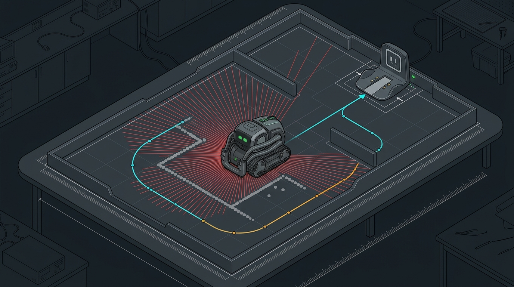
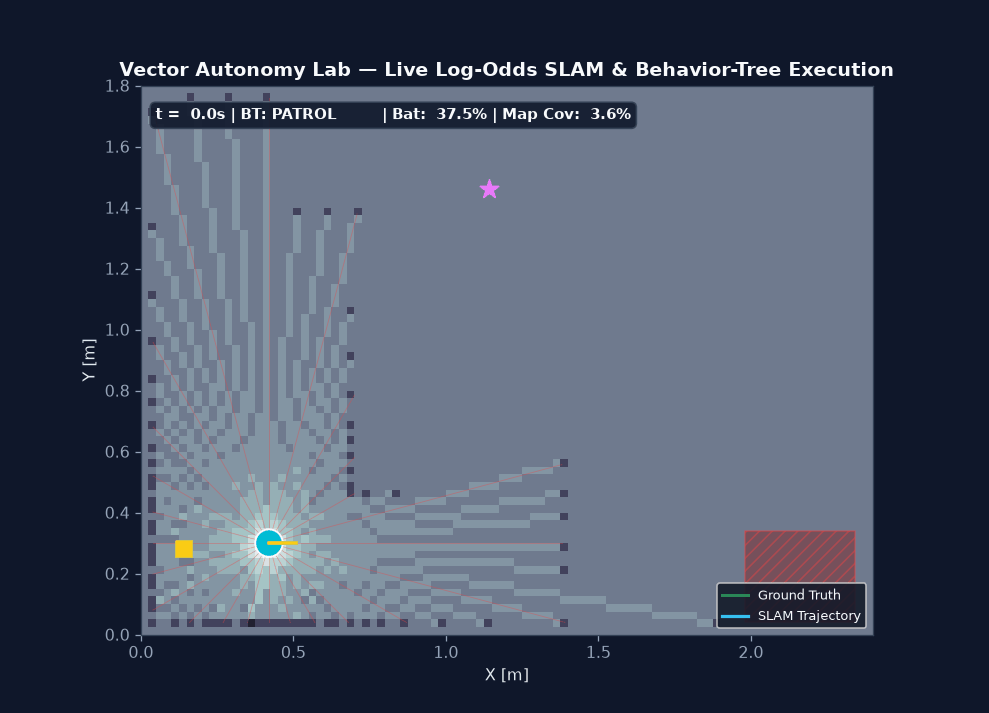
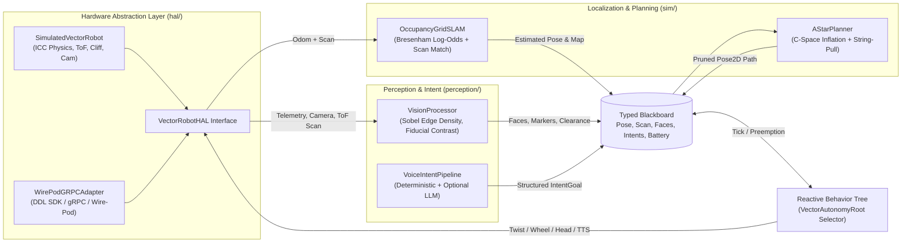
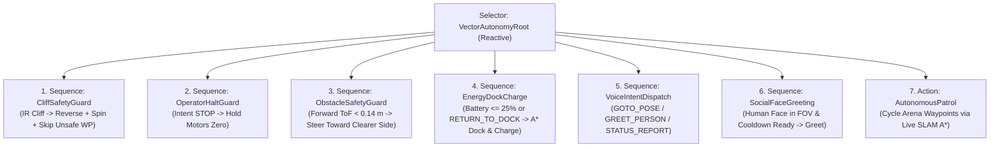
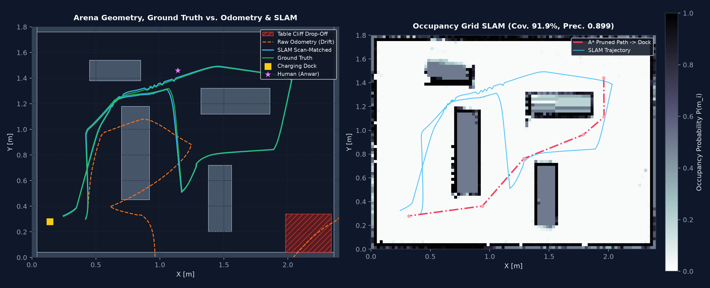
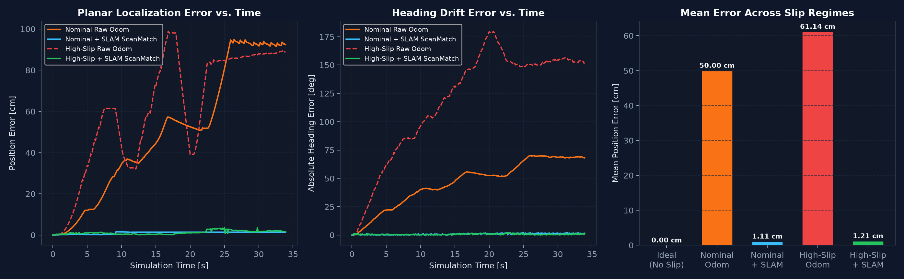
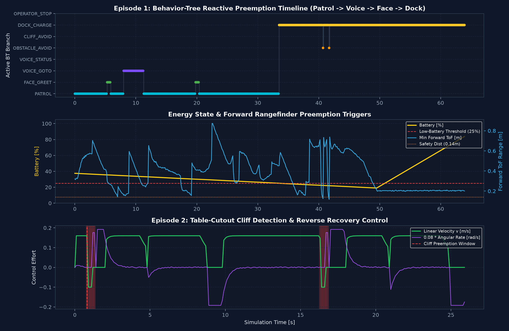

# vector-autonomy-lab

**PhD-Grade Robotics, Embodied AI, Behavior-Tree Autonomy & Occupancy-Grid SLAM Lab for Anki / Digital Dream Labs (DDL) Vector**


<p align="center">
  
  <br/>
  <em>Concept Schematic (AI-generated architectural illustration): Compact tracked companion robot operating inside a tabletop/indoor SLAM & autonomous docking research arena. Quantitative plots and telemetry below are generated from deterministic Python simulations.</em>
</p>

---

## Live Simulated SLAM Exploration & Behavior-Tree Execution

<p align="center">
  
  <br/>
  <em>Deterministic 640-tick closed-loop episode (63.9 s @ 10 Hz): Vector maps 91.9% of the 2.4 m x 1.8 m lab arena using Bayesian log-odds SLAM, executes a voice-commanded <code>GOTO_POSE</code>, greets a detected human face, and autonomously preempts patrol at 25% battery to navigate via A* back to its charging dock.</em>
</p>

---

## Overview

`vector-autonomy-lab` implements a complete, hardware-agnostic embodied AI autonomy stack modeled on the **Anki / DDL Vector** platform (`track_width = 0.048 m`, 4-corner IR cliff sensors, forward ToF rangefinder, head/lift actuators, OLED eye feedback, camera stream, and Wire-Pod/gRPC control):

1. **Hardware Abstraction Layer (`src/vector_lab/hal/`)**: Unified `VectorRobotHAL` interface with a deterministic physics-backed `SimulatedVectorRobot` backend and a `WirePodGRPCAdapter` for physical DDL Vector hardware (`create_robot_hal(serial)`).
2. **Behavior-Tree Autonomy Engine (`src/vector_lab/behavior_tree/`)**: Composable `Sequence`, `Selector`, `Parallel`, `Inverter`, `Condition`, and `Action` nodes implementing reactive priority preemption across cliff safety, operator stop, obstacle avoidance, low-battery dock charging, voice-intent execution, social face greeting, and arena patrol.
3. **Vision & Voice-Intent Pipeline (`src/vector_lab/perception/`)**: Deterministic Sobel-gradient edge density & fiducial ROI contrast feature extraction fused with ToF scans, plus a `DeterministicIntentParser` and optional HTTP `LLMIntentAdapter` (with safe offline fallback).
4. **2D/3D Kinematics, Log-Odds SLAM & A* Planner (`src/vector_lab/sim/`)**: Exact Instantaneous Center of Curvature (ICC) differential-drive kinematics, noisy wheel-encoder slip model, slab ray-AABB ToF rangefinder, clamped Bayesian log-odds occupancy-grid SLAM with local correlative scan matching, and 8-connected A* with Euclidean C-space inflation and Bresenham string-pulling.

---

## System Architecture



### Behavior-Tree Priority Hierarchy



---

## Mathematical Foundations

### 1. Differential-Drive Unicycle Kinematics & Exact ICC Integration

Given tread track width $L = 0.048\text{ m}$ and left/right linear tread speeds $(v_L, v_R)$, body linear velocity $v$ and yaw rate $\omega$ satisfy:

$$
v = \frac{v_L + v_R}{2}, \qquad \omega = \frac{v_R - v_L}{L}, \qquad v_L = v - \frac{L}{2}\omega, \qquad v_R = v + \frac{L}{2}\omega
$$

When actuator saturation occurs ($\max(|v_L|, |v_R|) > v_{\max}$), both wheel speeds are scaled uniformly to preserve the instantaneous turning curvature $\kappa = \omega / v$. Over step $\Delta t$, pose $(x_k, y_k, \theta_k) \in SE(2)$ is integrated exactly along the Instantaneous Center of Curvature (ICC) arc for $|\omega| \ge 10^{-7}$:

$$
x_{k+1} = x_k + \frac{v}{\omega}\Big(\sin(\theta_k + \omega \Delta t) - \sin\theta_k\Big), \qquad
y_{k+1} = y_k - \frac{v}{\omega}\Big(\cos(\theta_k + \omega \Delta t) - \cos\theta_k\Big), \qquad
\theta_{k+1} = \operatorname{wrap}(\theta_k + \omega \Delta t)
$$

### 2. Clamped Bayesian Log-Odds Occupancy-Grid SLAM

Each grid cell $m_i$ (resolution $\Delta = 0.025\text{ m}$) stores occupancy log-odds $L(m_i) = \ln \frac{P(m_i)}{1 - P(m_i)}$ initialized to $l_0 = 0.0$ ($P = 0.5$). For each ToF ray traced via integer Bresenham line rasterization:

$$
L_t(m_i) = \operatorname{clip}\!\Big(L_{t-1}(m_i) + l_{\text{inv}}(m_i; x_t, z_t) - l_0,\; L_{\min},\; L_{\max}\Big), \qquad
P(m_i \mid z_{1:t}, x_{1:t}) = \frac{1}{1 + e^{-L_t(m_i)}}
$$

with $l_{\text{occ}} = +0.85$ at valid hit endpoints ($r < r_{\max}$), $l_{\text{free}} = -0.35$ along traversed ray interiors, and clamping bounds $[L_{\min}, L_{\max}] = [-4.0, 4.0]$. To bound wheel-slip drift, `OccupancyGridSLAM.correlative_scan_match` refines the odometry-propagated pose over a local $(dx, dy, d\theta)$ window maximizing scan-endpoint occupancy likelihood with a quadratic odometry prior.

---

## Quantitative Simulation Proof

All metrics below are directly measured from deterministic runs of `scripts/run_simulations.py` (archived in [`docs/proof/simulation_metrics.json`](docs/proof/simulation_metrics.json)).

### Episode 1 & 2 Highlights (`SimulatedVectorRobot`, 10 Hz)

| Metric | Observed Value | Notes |
| --- | --- | --- |
| Episode 1 Duration / Steps | `63.9 s` (`640` ticks) | Patrol + Voice `GOTO_POSE` + Face Greet + Low-Battery Dock Charge |
| SLAM Explored Map Coverage | **91.87%** | `0.025 m` cell resolution across `2.40 m x 1.80 m` arena |
| Occupied-Cell Precision / IoU | **0.8993** / **0.7580** | `661` TP cells, `74` FP cells against ground truth |
| Mean Raw Odometry Drift (Ep. 1) | `165.833 cm` | Uncorrected 1.5% tread bias + Gaussian slip over 63.9 s |
| Mean SLAM Scan-Matched Error (Ep. 1) | **0.705 cm** | `> 235x` drift reduction via local correlative scan matching |
| Final Battery State (Ep. 1) | `37.5% -> <25% -> 83.79%` | Autonomous dock return at ~33.6 s, docked recharge from ~49.5 s |
| Cliff Safety Recovery (Ep. 2) | `12` recovery ticks | Immediate reverse + spin + unsafe-waypoint skip on SE cutout |

### Odometry Drift vs. SLAM Scan-Matching Ablation (340 ticks / 34.0 s)

| Slip Regime | Mean Raw Odom Error | Mean SLAM Error | Max Raw Odom Error | Max SLAM Error |
| --- | --- | --- | --- | --- |
| Ideal (Zero Slip) | `0.000 cm` | — | — | — |
| Nominal Slip (`±1.5%` bias) | `49.997 cm` | **1.106 cm** | `94.905 cm` | **1.607 cm** |
| High Slip (`±4.0%` bias) | `61.142 cm` | **1.209 cm** | `98.944 cm` | **3.561 cm** |

<p align="center">
  
</p>

<p align="center">
  
</p>

<p align="center">
  
</p>

---

## Tools, Skills, Robotics & AI Stack

| Domain | Technologies & Methods Implemented |
| --- | --- |
| **Robotics Hardware & Middleware** | Anki / DDL Vector Hardware Abstraction Layer (`VectorRobotHAL`), Wire-Pod REST/intent URL & DDL Vector gRPC SDK payload translation (`WirePodGRPCAdapter`), differential-drive tread actuation (`drive_twist`, `set_wheel_speeds`), 4-corner IR cliff & ToF rangefinder modeling |
| **Kinematics & Control** | Exact SE(2) ICC arc integration, curvature-preserving tread saturation, proportional turn-and-drive unicycle trajectory tracking, systematic scale-bias + Gaussian slip odometry |
| **SLAM & Path Planning** | Clamped Bayesian log-odds 2D occupancy grid, integer Bresenham ray-tracing, local correlative scan matching, Euclidean C-space obstacle inflation, 8-connected A* with octile heuristic & line-of-sight string-pulling |
| **Embodied AI & Behavior Trees** | Reactive priority `Selector`, `Sequence`, `Parallel`, `Inverter`, `Condition`, `Action` nodes; typed `Blackboard` bus; safety/energy/intent/social preemption |
| **Computer Vision & NLP** | Vectorized NumPy Sobel-gradient edge density & fiducial contrast extraction (`VisionProcessor`), synthetic perspective camera renderer, deterministic regex/keyword voice-intent parser (`DeterministicIntentParser`) + optional OpenAI-compatible `LLMIntentAdapter` |
| **Engineering & Verification** | Python 3.12, NumPy, Matplotlib, Pillow, `pytest` (13 unit & closed-loop integration tests), `ruff` static linting |

---

## Repository Structure

```text
vector-autonomy-lab/
├── docs/
│   ├── CASE_STUDY.md
│   ├── PROOF_OF_WORK.md
│   ├── images/vector-lab-hero.png
│   └── proof/
│       ├── slam_exploration.gif
│       ├── slam_occupancy_trajectory.png
│       ├── kinematics_odometry_error.png
│       ├── behavior_tree_timeline.png
│       └── simulation_metrics.json
├── scripts/
│   └── run_simulations.py
├── src/vector_lab/
│   ├── types.py
│   ├── hal/          # VectorRobotHAL, SimulatedVectorRobot, WirePodGRPCAdapter, factory
│   ├── behavior_tree/# Composable BT primitives & VectorAutonomyController
│   ├── perception/   # VisionProcessor, DeterministicIntentParser, LLMIntentAdapter
│   └── sim/          # Kinematics, Arena2D, OccupancyGridSLAM, AStarPlanner, Runner
└── tests/            # Unit, invariant, preemption, and closed-loop integration tests
```

---

## Quickstart

```bash
# 1. Clone and install in editable mode with dev dependencies
git clone https://github.com/Anwarito-lbd/vector-autonomy-lab.git
cd vector-autonomy-lab
pip install -e ".[dev]"

# 2. Run full test suite & linter
pytest -v
ruff check src tests scripts

# 3. Run multi-episode deterministic simulations & regenerate plots/GIF
python scripts/run_simulations.py
```

### Switching Between Simulation and Physical DDL Vector

```python
from vector_lab.hal import create_robot_hal

# Deterministic simulation (default when target is None or "sim")
sim_robot = create_robot_hal(None, initial_battery_pct=80.0, seed=42)

# Physical DDL Vector via Wire-Pod / gRPC SDK (requires `pip install -e ".[hardware]"`)
real_robot = create_robot_hal("00e12345", host="192.168.1.50")
```

---

## Documentation

- [**Engineering Case Study (`docs/CASE_STUDY.md`)**](docs/CASE_STUDY.md) — Architectural design decisions, SLAM drift ablation analysis, and reactive Behavior-Tree safety engineering.
- [**Proof of Work (`docs/PROOF_OF_WORK.md`)**](docs/PROOF_OF_WORK.md) — Verbatim verification logs, environment inventory, and artifact audit.
